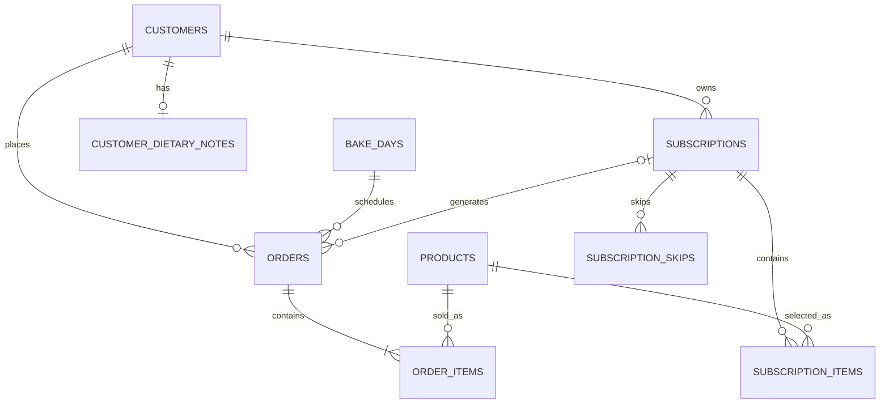

# MNTL data model and analytics handoff

_Updated 2026-10-29. This documents the **actual live Supabase relational schema** and the **separate browser-only demo fixtures**. It is intended as a foundation for a future Databricks/dbt/BI analytics model._

## What is real versus simulated?

The production PostgreSQL tables are the **source of truth**. Sample records are generated by `admin/demoData.js` and stored only in the authenticated admin's React state while Demo Mode is enabled. They are **never inserted into Supabase**, are not sent to Stripe and are not shown on the public customer website. Demo edits reset with **Reset demo** and are discarded on reload / sign-out. The fictional addresses and contacts are placeholders.

Switching Demo Mode off switches the interface back to `liveRecords`, which were fetched with the authenticated user's access token and Supabase row-level security.

## Primary keys and relationship audit

The PostgreSQL catalogs were inspected on 2026-10-29. **All 14 existing public tables have primary keys**. The business entities have enforced foreign keys. Additional read-path indexes were applied and verified in production; the reproducible SQL is [docs/sql/analytics_indexes.sql](sql/analytics_indexes.sql).

| Table | Row grain / primary key | Important relationships |
| --- | --- | --- |
| `customers` | One customer / `id UUID` | Email is case-insensitive unique for non-null values |
| `products` | One product / `id UUID` | Ingredient/allergen description lives on product |
| `bake_days` | One production date / `id UUID` | `bake_date` has a unique constraint |
| `orders` | One checkout/manual order / `id UUID` | `customer_id` → customers; `bake_day_id` → bake_days; optional `subscription_id` → subscriptions |
| `order_items` | One order line / `id UUID` | `order_id` → orders; `product_id` → products |
| `subscriptions` | One recurring plan / `id UUID` | `customer_id` → customers; Stripe subscription ID unique when set |
| `subscription_items` | One recurring product line / `id UUID` | `subscription_id` → subscriptions; `product_id` → products |
| `subscription_skips` | One skip per plan/date / **composite PK** (`subscription_id`, `bake_date`) | `subscription_id` → subscriptions |
| `customer_dietary_notes` | One restricted note record per customer / `customer_id UUID` | Primary key doubles as FK → customers; sensitive |
| `staff` | One authorized staff member / `user_id UUID` | PK + FK → `auth.users`; roles restrict access |
| `bake_updates` | One manually published batch update per date / `bake_date DATE` | **Natural PK**; public read only when `published = true` |
| `checkout_holds` | One future temporary inventory reservation / `id UUID` | `bake_day_id` → bake_days; server-only |
| `stripe_events` | One received webhook event / `event_id TEXT` | Primary key acts as event deduplication key; server-only |
| `audit_events` | One audit record / `id UUID` | `actor_user_id` → `auth.users`; server-only |

All monetary amounts are stored as integer Canadian cents (`*_cents`), **not float**. `order_items.unit_price_cents` snapshots the selling price at time of order so historical revenue does not change when `products.price_cents` changes. Foreign keys, quantity checks and enumerated status constraints are enforced by PostgreSQL.

### Relationship sketch



## Recommended BI grains and metrics

**Dimensional model (future Gold layer)**: `dim_customer`, `dim_product`, `dim_date`, `dim_subscription`; `fact_order` (one row per order), `fact_order_item` (one row per paid/unpaid line), `fact_subscription_interval` (one plan/billing period), `fact_bake_plan` (one date/product).

Do not combine payment states incorrectly:

- **Confirmed loaf units** = paid order items linked to a bake date, excluding cancelled and refunded orders. Group by `bake_days.bake_date, products.id`. Treat quantities, not order count, as production volume.
- **Paid order count** = distinct paid orders; group separately by fulfillment type to measure pickup/drop-off workload.
- **Unpaid units** = separate forecast/risk metric. Never silently add to confirmed production.
- **Subscription forecast** = calculated recurring demand, not a paid invoice or confirmed revenue. When a paid order exists for the same subscription/date, exclude that forecast to avoid double counting.
- **Lifetime spend** = sum of paid, non-cancelled order totals per customer. **Refund reporting must be expanded** before claiming net revenue.
- **Customer cohorts** = first paid order's date, not first email signup date, unless explicitly analyzing signups.
- **Marketing consent** = point-in-time `customers.marketing_opt_in`; this **does not provide consent history**.

### Sample operational production query

```sql
SELECT
  b.bake_date,
  p.id AS product_id,
  p.name AS product_name,
  SUM(oi.quantity) AS confirmed_loaves,
  COUNT(DISTINCT o.id) AS paid_orders,
  SUM(oi.quantity * oi.unit_price_cents) AS gross_line_revenue_cents
FROM public.orders o
JOIN public.bake_days b ON b.id = o.bake_day_id
JOIN public.order_items oi ON oi.order_id = o.id
JOIN public.products p ON p.id = oi.product_id
WHERE o.payment_status = 'paid'
  AND o.status <> 'cancelled'
GROUP BY b.bake_date, p.id, p.name
ORDER BY b.bake_date, p.name;
```

The result excludes refunds as represented by `payment_status = 'refunded'`, but **cannot handle partial refunds** until refund rows are modeled.

### Suggested future enhancements, not yet implemented

- **Customer address dimension** (multiple verified addresses per customer, an optional default, and a snapshot/FK on each order). Today the customer has one set of address fields and `orders.delivery_address` is a historical text snapshot. The UI deliberately shows the customer's saved address or last delivery snapshot.
- **Marketing consent event history** (who, when, channel, consent wording, withdrawal). Do not infer historical permission from today's boolean.
- **Order status transitions and refunds ledger** for reliable operational turnaround-time and net-revenue analytics. A single current status cannot reconstruct historical changes; don't guess.
- **Reliable currency/tax/fee components** on order totals and immutable payment facts, then a reconciliation model against Stripe.
- **Customer identity / merging rules** for potential duplicate guest checkout emails, and `updated_at` timestamps on mutable entities.
- **Volume strategy**: the admin currently fetches up to 1,000 rows **per table**. Before significant sales, introduce pagination or server-side aggregations. A maximum row limit is not a valid analytics source for historical reporting.
- **Analytics privacy**: keep names, emails, phones, delivery addresses and dietary notes outside general-purpose BI marts; expose only approved access-controlled dimensions and aggregated metrics.

## Reconciliation & QA

- `tests/demo-data.test.mjs` checks deterministic fixture IDs, uniqueness and FK-like relationships, sample financial totals, and local-only mutations. `npm run build` runs those tests before Vite compilation.
- The fixture graph is *representative* but generated in memory; its `paid` statuses are synthetic and do not represent real Stripe transactions.
- Confirm database constraints with `pg_constraint` and indexes with `pg_indexes`, not by assuming the UI provides guarantees.
- Never seed demo contacts into production; never disable RLS to make an admin screen work.
- A historical SQL model should exclude demo data **by design** (none is persisted in the production database).
